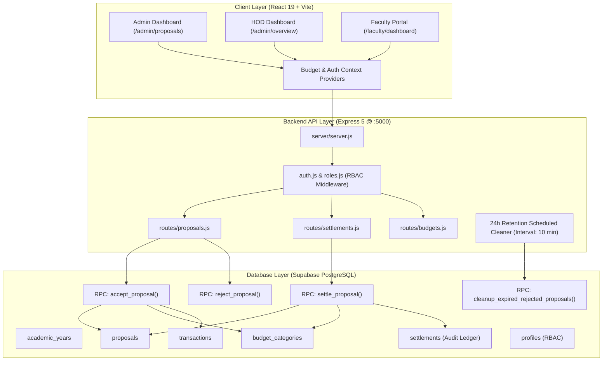

# Kongu Engineering College (Autonomous)
## Department of Computer Science and Engineering
### Budget Management, Allocation & Proposal Governance System

[](https://nodejs.org/)
[](https://react.dev/)
[](https://expressjs.com/)
[](https://supabase.com/)
[](https://kongu.ac.in/)

---

## 📌 Executive Overview

The **College Budget Management System (CBM)** is an enterprise financial planning, proposal lifecycle governance, and departmental expenditure tracking platform custom-built for the **Department of Computer Science and Engineering (CSE)** at **Kongu Engineering College**.

The platform manages the complete financial pipeline—from institutional annual academic year allocations and association quotas (CSEA, CCC, Labs, R&D) to faculty activity proposals, immediate budget deductions, administrative accept/reject evaluations, automated 24-hour retention cleanups, and post-event financial settlements.

---

## 🏛️ System Architecture



---

## 🌟 Core Financial Governance Workflows

### 1. Role-Based Access Control (RBAC)
- **Administrator (Principal / Dean / Budget Chair)**:
  - Full management of Academic Years, Category Quotas, and Department Allocations.
  - **Exclusive Authority** to **Accept** or **Reject** pending proposals.
  - Finalizes financial settlements and accesses departmental audit ledgers.
- **Head of Department (HOD)**:
  - Department-wide expenditure and proposal monitoring.
  - Can initiate and record activity settlements post-event.
  - Restricted from accepting/rejecting proposals (returns `403 Forbidden` on backend).
- **Faculty Members**:
  - Submits activity/event proposals against active academic year categories.
  - Tracks personal financial quota utilization, proposal statuses, and settlement values.
  - Completely restricted from admin/HOD evaluation actions.

---

### 2. Immediate Budget Deduction on Acceptance
When an Admin accepts a faculty proposal:
1. **Quota Sufficiency Check**: Verifies that the proposal's requested amount does not exceed the category's available quota ($\text{allocated} - \text{spent}$).
2. **Duplicate Prevention**: Rejects proposals already in `Accepted` or `Rejected` status.
3. **Atomic Deduction**: Immediately increments the category `spent_amount` by the proposed amount.
4. **Audit Record**: Records `accepted_at` timestamp, `reviewed_by` Admin ID, and generates a linked ledger transaction.

---

### 3. Settlement Replaces Proposed Amount (Net Adjustment)
Once an accepted activity or event is completed, the settlement workflow reconciles actual expenditures:
- **Zero Double-Deduction**: The settlement amount **replaces** the provisional proposed amount rather than adding onto it.
- **Dynamic Variance Math**:
  $$\Delta = \text{Actual Settlement Amount} - \text{Previously Deducted Amount}$$
  - **Under-budget Example**: Proposed ₹10,000, settled at ₹8,000 $\rightarrow \Delta = -₹2,000$. The ₹2,000 difference is **credited back** immediately to the category's available budget.
  - **Over-budget Example**: Proposed ₹10,000, settled at ₹12,000 $\rightarrow \Delta = +₹2,000$. The system verifies quota availability and deducts an additional ₹2,000.
- **Audit Ledger**: The original proposed amount is preserved permanently on the `proposals` table. All adjustment events are logged to the `public.settlements` audit table.

---

### 4. 24-Hour Automated Retention for Rejected Proposals
- When an Admin rejects a proposal, `rejected_at` is stamped.
- **Automated Backend Cleanup Job**:
  - Runs in `server/server.js` every 10 minutes.
  - Purges all rejected proposals where `rejected_at <= NOW() - 24 hours`.
  - Cascades deletion of dependent transactions and settlement drafts.
- **PostgreSQL Database Scheduled Procedure**:
  - Stored procedure `cleanup_expired_rejected_proposals()` can be triggered via `pg_cron` or Supabase Edge Functions.
- **Fail-safe Client Filtering**: Proposals past the 24-hour mark are automatically filtered out of views even before the background cleaner cycle runs.

---

### 5. Unified Budget Calculation Formula (Rule 6)

$$\text{Available Budget} = \text{Annual Budget} - \sum(\text{Unsettled Accepted Proposals}) - \sum(\text{Finalized Settlement Expenses}) - \sum(\text{Independent Expenses})$$

- **Unsettled Accepted Proposals**: Deducted provisionally using the approved proposal amount.
- **Finalized Settlements**: Deducted using the verified settlement amount only (the original proposed amount is released).
- **Pending & Rejected Proposals**: Do not affect the available budget.

---

## 🛠️ Technology Stack

| Domain | Technology | Details |
|---|---|---|
| **Frontend Framework** | React 19 + Vite | Fast HMR, component-driven UI |
| **Routing** | React Router v7 | Protected routes, layout-driven navigation |
| **Icons & Charts** | Lucide React & Recharts | Clean dashboards and data visualizations |
| **Styling** | Vanilla CSS Design System | Responsive, KEC institutional theme, dark/light contrast |
| **Backend Runtime** | Node.js + Express 5 | RESTful API, asynchronous transactional logic |
| **Database & Auth** | Supabase (PostgreSQL 15) | Row-Level Security (RLS), ACID Stored Procedures (RPC) |
| **Job Scheduling** | Node `setInterval` + PostgreSQL RPC | Dual-layer 24h retention garbage collector |

---

## 📁 Project Directory Structure

```
budget_management/
├── server/
│   ├── middleware/
│   │   ├── auth.js               # Supabase JWT token verification
│   │   └── roles.js              # requireAdmin, requireHod, requireFaculty
│   ├── routes/
│   │   ├── academicYears.js      # Academic session lifecycle management
│   │   ├── auth.js               # User authentication & role dispatch
│   │   ├── budgets.js            # Summary analytics & dashboard endpoints
│   │   ├── categories.js         # Category quota allocations & subcategories
│   │   ├── faculty.js            # Faculty profiles & departmental directory
│   │   ├── proposals.js          # Proposal CRUD, Accept, Reject, Settle routes
│   │   ├── settlements.js        # Dedicated settlements audit endpoints
│   │   └── transactions.js       # Financial transactions ledger
│   ├── supabaseClient.js         # Privileged service-role Supabase client
│   └── server.js                 # Express server & background retention cleaner
├── src/
│   ├── components/
│   │   ├── common/               # Badge, Button, Modal, Skeleton loaders
│   │   ├── dashboard/            # Metrics cards, charts, transaction views
│   │   └── layout/               # Admin, HOD, and Faculty navigation layouts
│   ├── context/
│   │   ├── AuthContext.jsx       # User session state & permission gates
│   │   ├── AuthProvider.jsx      # Authentication state management
│   │   ├── BudgetContext.jsx     # Budget state hook
│   │   └── BudgetProvider.jsx    # Real-time proposals, quota & settlement state
│   ├── lib/
│   │   ├── api.js                # Authenticated REST fetch client
│   │   └── supabase.js           # Client-side Supabase anonymous instance
│   ├── pages/
│   │   ├── AcademicYearsPage.jsx # Academic session management
│   │   ├── AdminProposalsPage.jsx# Admin proposal evaluation & settlement modal
│   │   ├── BudgetOverviewPage.jsx# Department category quotas & utilization
│   │   ├── CCCPage.jsx           # Competitive Coding Club association portal
│   │   ├── CSEAPage.jsx          # CSE Association portal
│   │   ├── DashboardPage.jsx     # Executive departmental budget dashboard
│   │   ├── FacultyDashboardPage.jsx # Faculty activity quota & balance
│   │   ├── FacultyProposalsPage.jsx # Faculty proposals registry & live tracking
│   │   ├── NewProposalPage.jsx   # Institutional proposal submission form
│   │   └── ReportsPage.jsx       # CSV spreadsheet generation & audit dossier
│   ├── App.jsx                   # Application route configurations
│   ├── index.css                 # Master institutional CSS design tokens
│   └── main.jsx                  # Application bootstrap
├── supabase/
│   └── migrations/
│       └── 20261024000000_proposal_acceptance_settlement_and_cleanup.sql
├── server.js                     # Root entrypoint redirecting to server/server.js
├── supabase_migration.sql        # Comprehensive SQL schema & stored procedures
└── package.json                  # Project dependencies & scripts
```

---

## 🔌 API Endpoints Reference

### Proposals (`/api/proposals`)
| Method | Endpoint | Access | Description |
|---|---|---|---|
| `GET` | `/api/proposals` | Authenticated | Retrieves proposals (Admin/HOD sees all; Faculty sees own). Filters expired rejected proposals. |
| `POST` | `/api/proposals` | Faculty / Admin | Submits a new activity proposal with program dates and schedule. |
| `POST` | `/api/proposals/:id/accept` | **Admin Only** | Accepts proposal and immediately deducts amount from category budget. |
| `POST` | `/api/proposals/:id/reject` | **Admin Only** | Rejects proposal, records `rejected_at`, and schedules deletion after 24h. |
| `POST` | `/api/proposals/:id/settle` | Admin / HOD | Settles proposal, replacing provisional amount with actual settlement amount. |
| `PATCH`| `/api/proposals/:id/status` | Admin / HOD | Updates proposal status (`Under Review`, etc.). Enforces Admin for Accept/Reject. |

### Settlements (`/api/settlements`)
| Method | Endpoint | Access | Description |
|---|---|---|---|
| `GET` | `/api/settlements` | Admin / HOD | Retrieves audit ledger of all finalized activity settlements. |
| `POST`| `/api/settlements` | Admin / HOD | Reconciles and records an event settlement against an accepted proposal. |

### Analytics & Budgets (`/api/budgets` & `/api/dashboard`)
| Method | Endpoint | Access | Description |
|---|---|---|---|
| `GET` | `/api/dashboard` | Authenticated | Returns real-time annual budget, committed proposals, settlements, and category usage. |
| `GET` | `/api/budgets/summary` | Authenticated | Department-level financial summary for the active academic year. |

---

## 💾 Database Setup & Migrations

All schema definitions, indexes, Row-Level Security (RLS) policies, and atomic stored procedures are maintained in:
- `supabase_migration.sql`
- `supabase/migrations/20261024000000_proposal_acceptance_settlement_and_cleanup.sql`

### Applying Migrations
1. Open your **Supabase Dashboard** $\rightarrow$ Navigate to **SQL Editor**.
2. Paste the contents of [supabase_migration.sql](file:///d:/budget_management/supabase_migration.sql) and execute.
3. The migration configures:
   - Schema alterations for `rejected_at`, `accepted_at`, `approved_amount`, and `settlement_amount`.
   - The `public.settlements` audit table.
   - Stored procedures: `accept_proposal()`, `reject_proposal()`, `settle_proposal()`, and `cleanup_expired_rejected_proposals()`.

---

## 🚀 Getting Started

### 1. Prerequisites
- **Node.js** (v18.0.0 or higher)
- **npm** (v9.0.0 or higher)
- A **Supabase** project instance

### 2. Environment Variables Configuration

Create a `.env` file at the project root for the frontend:
```env
VITE_SUPABASE_URL=https://your-project.supabase.co
VITE_SUPABASE_PUBLISHABLE_KEY=your-supabase-anon-key
VITE_API_URL=http://localhost:5000
```

Create a `server/.env` file for the backend server:
```env
PORT=5000
SUPABASE_URL=https://your-project.supabase.co
SUPABASE_SECRET_KEY=your-supabase-service-role-key
```

### 3. Install Dependencies
```bash
npm install
```

### 4. Run Locally
To launch both the backend Express server (`http://localhost:5000`) and the Vite frontend (`http://localhost:5173`) concurrently:
```bash
npm run start
```

Alternatively, you can run services individually in separate terminals:
```bash
# Terminal 1: Backend API
npm run server

# Terminal 2: Frontend Client
npm run dev
```

---

## 📊 Comprehensive Audit Reports Export

From the **Reports & Audits** tab (`/admin/reports`), administrators can export live CSV worksheets:
1. **Category Budget Allocation Statement**: Category quotas, committed funds, actual disbursed expenses, and utilization %.
2. **Activity Proposals & Approvals Dossier**: All submitted proposals with proposed vs. approved vs. settled amounts and administrative remarks.
3. **Financial Transactions Ledger**: Real-time transaction history with IDs, dates, descriptions, and reference proposal numbers.
4. **Faculty Activity Roster**: Department faculty roster with total proposals submitted and approved funding totals.

---

## 🔒 Security Best Practices

- **Service-Role Key Protection**: Privileged database operations are executed strictly on the Express backend using `SUPABASE_SECRET_KEY`. The service-role key is never bundled or exposed in frontend client code.
- **Strict Role-Based Middleware**: Every mutating endpoint (`accept`, `reject`, `settle`) validates the caller's verified Supabase profile role on the server before executing.
- **Race Condition & Overdraw Defense**: PostgreSQL row-level locks (`FOR UPDATE`) and atomic operations prevent concurrent requests from overdrawing budget quotas or executing duplicate deductions.

---

## 🏫 Institutional Credits

Developed for the **Department of Computer Science and Engineering**, **Kongu Engineering College (Autonomous)**, Perundurai, Erode — 638060, Tamil Nadu, India.
